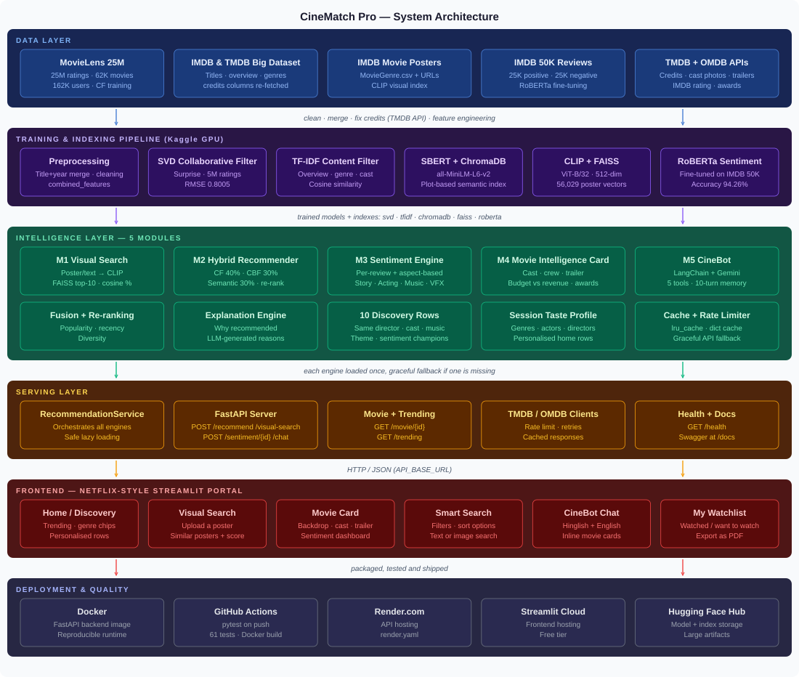
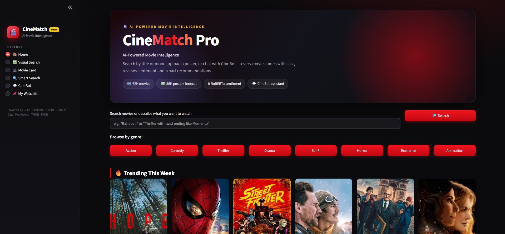
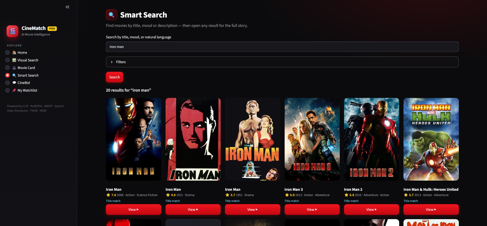
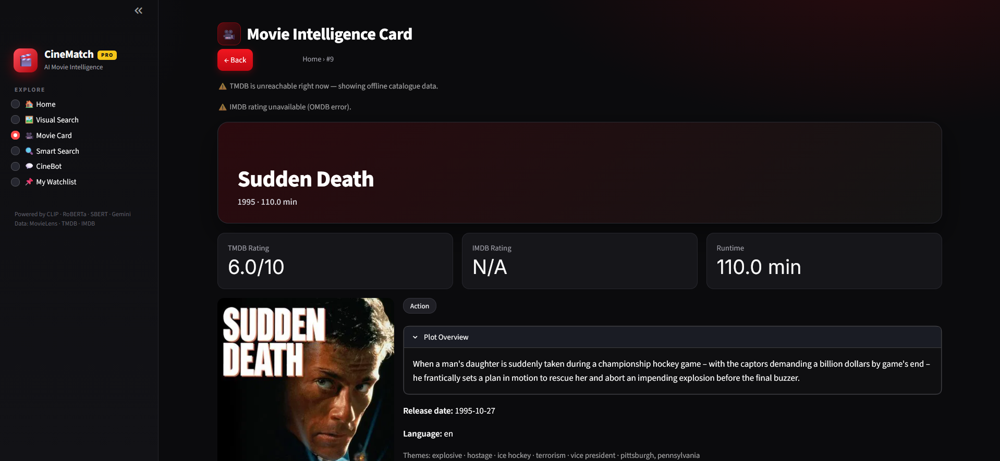
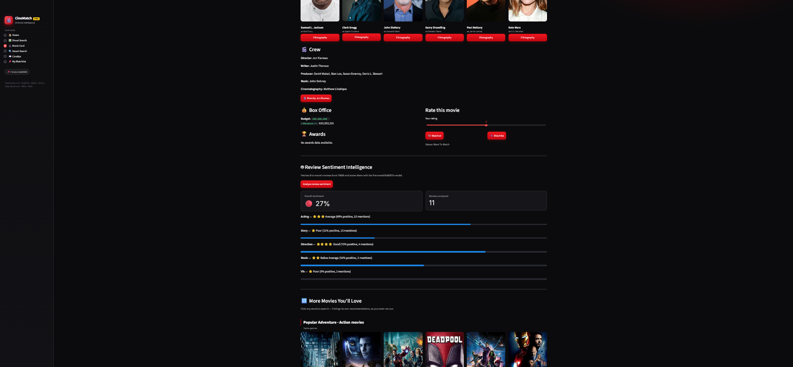
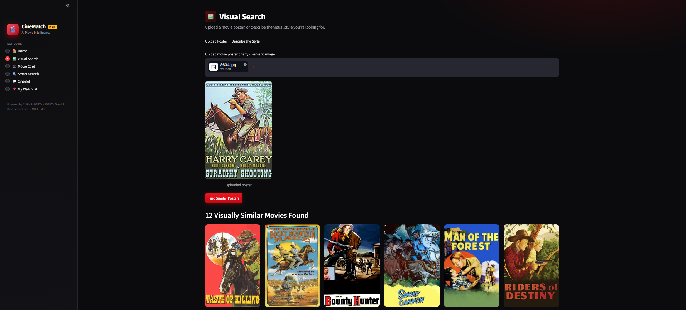
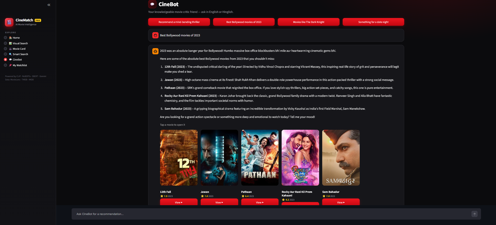
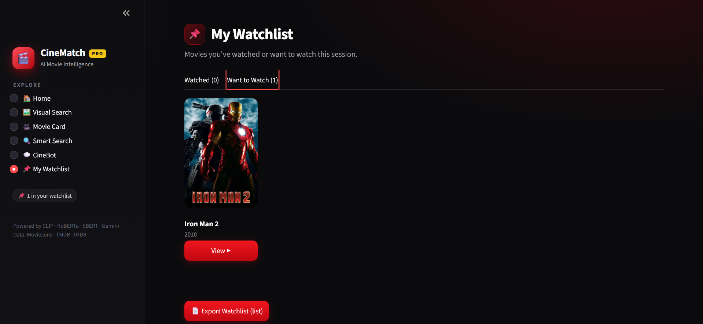
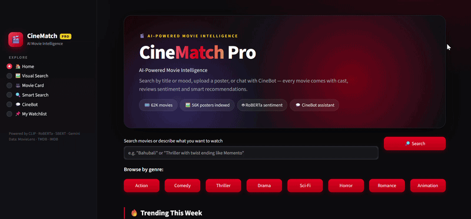

# 🎬 CineMatch Pro — Movie Recommendation + Review Intelligence Platform

[](https://github.com/narendrakalam2001/cinematch-pro/actions)
[](https://python.org)
[](https://fastapi.tiangolo.com)
[](https://streamlit.io)
[](https://huggingface.co/docs/transformers)
[](https://github.com/facebookresearch/faiss)
[](https://www.trychroma.com)
[](https://python.langchain.com)
[](https://docker.com)
[](https://www.themoviedb.org/documentation/api)
[](LICENSE)

> **Domain:** Entertainment / Media Tech — OTT personalization and discovery  
> **Problem:** Recommendations are black boxes, you can't search by poster, and review sentiment is scattered across many sites  
> **Solution:** One platform combining **Computer Vision + NLP + Recommender Systems + LLM** — visual search, a hybrid explainable recommender, aspect-based review sentiment and a movie-critic chatbot  
> **Data:** [MovieLens 25M](https://grouplens.org/datasets/movielens/25m/) · [TMDB](https://www.themoviedb.org/) · [IMDB 50K reviews](https://www.kaggle.com/datasets/lakshmi25npathi/imdb-dataset-of-50k-movie-reviews) · [Movie posters](https://www.kaggle.com/datasets/neha1703/movie-genre-from-its-poster)  
> **Industry Context:** Netflix India · Amazon Prime Video · Hotstar · JioCinema · BookMyShow · PVR — every OTT and ticketing platform needs intelligent discovery

---

## 💡 Why This Project Matters

Streaming platforms show you a row of titles and no reason why. You can't search with a poster you saw on a hoarding, and to know whether a film is *actually* good you open five different sites. CineMatch Pro puts all of it in one place:

- **Reverse poster search** — upload any poster or cinematic image and a **CLIP** embedding is matched against **56,029 indexed posters** with **FAISS**
- **Hybrid recommender** — **SVD collaborative filtering (40%) + TF-IDF content filtering (30%) + SBERT semantic search (30%)**, fused and re-ranked, so every suggestion has a transparent *source*
- **Infinite Discovery Loop** — open any movie and get rows like *Same Director*, *Starring*, *Same Theme*, *Users Also Watched*; every card opens its own page with its own rows — you never run out of things to click
- **Aspect-based sentiment** — a **RoBERTa** model fine-tuned on 50K IMDB reviews, plus spaCy aspect extraction (**Story · Acting · Direction · Music · VFX**), instead of one opaque star rating
- **CineBot** — a Hinglish-friendly movie-critic chatbot (LangChain + Gemini) grounded in the platform's own tools, whose movie suggestions come back as **clickable cards**
- **Graceful degradation** — if TMDB, OMDB or Gemini is down, pages still load from the offline catalogue and say so, instead of crashing

This is a capstone built to production standards: type hints, docstrings, structured logging, env-based secrets, a 229-test pytest suite, Docker and GitHub Actions.

---

## 🏆 Model Results (Full Kaggle Training Run)

| Component | Model | Metric | Result | Target |
|---|---|---|---|---|
| **Sentiment** | RoBERTa (`cardiffnlp/twitter-roberta-base-sentiment`) fine-tuned on IMDB 50K | Accuracy | **`94.26%`** | > 93% ✅ |
| | | F1 | `94.29%` | — |
| **Collaborative filtering** | SVD (scikit-surprise) on **5,000,000** MovieLens ratings | RMSE | **`0.8005`** | < 0.87 ✅ |
| **Visual search** | CLIP `ViT-B/32` (512-dim) + FAISS `IndexFlatIP` | Posters indexed | **`56,029`** | — |
| **Content filter** | TF-IDF + cosine similarity | Movies covered | `62,423` | — |
| **Semantic search** | SBERT `all-MiniLM-L6-v2` + ChromaDB | Plots indexed | `52,703` ¹ | — |
| **Verified credits** | TMDB API (director · cast · composer · keywords) | Movies re-fetched | `20,060` ² | — |
| **Test suite** | pytest | Tests | `229` | — |

> ¹ Movies without a real plot overview (< 40 characters) are excluded from the semantic index — genre-only documents all embed identically and pollute search results (see [Engineering Notes](#-engineering-notes--data-quality-findings)).  
> ² The big TMDB/IMDB export has misaligned credit columns; the most-voted movies are re-fetched live from TMDB (see [Engineering Notes](#-engineering-notes--data-quality-findings)).  
> Every training script writes its real metrics and library versions to `models/model_card.json`.

---

## 🔗 Links

| Resource | Link |
|---|---|
| 📓 **EDA Notebook** | [notebooks/cinematch_pro_eda.ipynb](notebooks/cinematch_pro_eda.ipynb) |
| 🏋️ **Kaggle Training Notebook** (GPU pipeline, end to end) | [notebooks/Kaggle_Training.ipynb](notebooks/Kaggle_Training.ipynb) |
| 🚀 **FastAPI Swagger UI (local)** | `http://localhost:8000/docs` |
| 🎬 **Streamlit App (local)** | `http://localhost:8501` |
| 🌐 **Live demo** | _Deployment in progress — Streamlit Community Cloud (lite, free)_ |

---

## 🏗️ System Architecture



```
╔══════════════════════════════════════════════════════════════════════════════════════════╗
║ CINEMATCH PRO — 6-LAYER PRODUCTION SYSTEM                                                ║
╠══════════════════════════════════════════════════════════════════════════════════════════╣
║ DATA LAYER                                                                               ║
║   MovieLens 25M · IMDB/TMDB Big Dataset · Poster CSV · IMDB 50K Reviews · TMDB + OMDB    ║
║                                         ▼                                                ║
║ TRAINING & INDEXING PIPELINE  (Kaggle GPU — notebooks/Kaggle_Training.ipynb)             ║
║   Preprocessing + TMDB credits fix → SVD (CF) · TF-IDF · SBERT + ChromaDB                ║
║   CLIP + FAISS · RoBERTa fine-tuning (+ spaCy aspect extraction)                         ║
║                                         ▼                                                ║
║ INTELLIGENCE LAYER — 5 MODULES                                                           ║
║   M1 Visual Search · M2 Hybrid Recommender (CF 40 / CBF 30 / Semantic 30)                ║
║   M3 Sentiment Engine · M4 Movie Intelligence Card · M5 CineBot                          ║
║   + fusion/re-rank · discovery rows · session taste profile · cache + rate limiter       ║
║                                         ▼                                                ║
║ SERVING LAYER                                                                            ║
║   RecommendationService (safe lazy loading) → FastAPI                                    ║
║   GET  /search · /movie/{id} · /tmdb-movie/{id} · /person/{id} · /trending · /health     ║
║   POST /recommend · /visual-search · /visual-search/upload · /sentiment/{id} · /chat     ║
║                                         ▼                                                ║
║ FRONTEND — STREAMLIT PORTAL (6 screens)                                                  ║
║   Home · Visual Search · Movie Card · Smart Search · CineBot · My Watchlist              ║
║                                         ▼                                                ║
║ DEPLOYMENT & QUALITY                                                                     ║
║   Docker · GitHub Actions (pytest + Docker build) · HF Space · Streamlit Cloud           ║
╚══════════════════════════════════════════════════════════════════════════════════════════╝
```

---

## 📸 App Screenshots

### 🖥️ User Portal

Netflix-style dark portal — sidebar navigation, search, genre chips, trending row and session taste profile.



---

### 🔍 Smart Search

Search by title (spelling-tolerant), by mood/plot ("thriller with a twist ending") or browse by genre — with genre, year and rating filters. Every result is a clickable card.



---

### 🎥 Movie Intelligence Card

Backdrop banner · ratings (TMDB + IMDB) · cast with photos · crew · trailer · box office · awards · and the Infinite Discovery rows below.



---

### 🤖 Review Sentiment Intelligence

Fine-tuned RoBERTa on the movie's TMDB reviews — overall positive %, reviews analyzed, and per-aspect breakdown (Story · Acting · Direction · Music · VFX).



---

### 🖼️ Visual Search

Upload a poster (or describe a visual style) and get the most visually similar movie posters with similarity scores.



---

### 💬 CineBot

Ask in English or Hinglish. Movies CineBot mentions appear as cards you can click to open.



---

### 📌 My Watchlist

Mark movies as *Watched* or *Want to Watch* from any Movie Card.



---

## 🎬 System Demo



---

## ✨ Features — 5 Modules

### Module 1 — Visual Search Engine (Computer Vision)

| | |
|---|---|
| **Model** | `openai/clip-vit-base-patch32` — zero-shot, no training needed |
| **Index** | FAISS `IndexFlatIP` over L2-normalised 512-dim embeddings → inner product = cosine similarity |
| **Size** | 56,029 poster vectors (`faiss_poster.index`) |
| **Modes** | Upload a poster image · describe a visual style in text ("dark moody thriller poster") |
| **Output** | Top-N similar movies with cosine similarity % |

### Module 2 — Hybrid Recommendation Engine

| Signal | Method | Weight |
|---|---|---|
| **Collaborative** | SVD matrix factorisation (scikit-surprise) — "viewers like you also watched" | 40% |
| **Content-based** | TF-IDF over overview + genres + keywords + cast + director, cosine similarity | 30% |
| **Semantic** | SBERT embeddings of plots in ChromaDB — "same story, different words" | 30% |

Scores are fused, re-ranked (popularity · recency · diversity) and each result keeps its per-source scores (`source_scores`) so *why* it was recommended is inspectable. Cold-start users fall back to content-based signals.

### Module 3 — Sentiment Intelligence Engine (NLP)

- **RoBERTa** fine-tuned on 50K IMDB reviews (3 epochs, batch 16, LR 2e-5, 80/20 split) → **94.26% accuracy**
- **Aspect-based breakdown** with spaCy sentence extraction + keyword matching for **Story · Acting · Direction · Music · VFX** — each aspect gets stars, a label and a positive %
- Reviews are fetched live from TMDB per movie and scored on demand

### Module 4 — Movie Intelligence Card

Backdrop + poster · title, year, runtime, certificate · TMDB and IMDB ratings · genres, languages, studios · plot · **cast with photos** (click an actor for their filmography) · director / writers / producers / composer / cinematographer · trailer · budget vs revenue · awards (OMDB) · your rating · sentiment dashboard · **related-movie rows**.

Movies missing from MovieLens (e.g. new releases) open through TMDB (`/tmdb-movie/{id}`) with TMDB recommendations plus semantic "similar plots in our catalogue".

### Module 5 — CineBot (LLM)

- **LangChain + Gemini**, 10-turn conversation memory, Hinglish-friendly "movie-critic friend" persona
- **5 grounded tools:** `movie_search` (semantic) · `movie_details` (TMDB) · `recommendation_tool` (hybrid engine) · `sentiment_tool` · `trending_tool`
- Uses a transparent **plan → run tools → answer** loop (see [CineBot design](#-cinebot-design)); the movies it names are resolved to catalogue/TMDB titles and returned as clickable cards

### 🔁 Infinite Discovery Loop

Open any movie and the page builds its own recommendation rows:

| Row | Source |
|---|---|
| Popular movies with the same genres | Catalogue (genre overlap) |
| More like this | TF-IDF + SBERT plot similarity |
| By the same director / Starring the lead actor | Catalogue credits, with TMDB filmography fallback |
| Same music director · same theme/keywords · similar production scale | Catalogue metadata |
| Popular in the same language · international films with a similar plot | Language filter · cross-language semantic search |
| Users also watched | SVD collaborative filtering |
| Sentiment champions | Highest-sentiment movies in the same genre |

Every card opens that movie's own page (with its own rows); a breadcrumb (`Home › Inception › Interstellar`) and a **← Back** button keep navigation easy.

---

## 📁 Project Structure

```
cinematch-pro/
│
├── src/                                    # Core ML / data modules
│   ├── config.py                           # All settings · paths · model names · fusion weights · aspect keywords
│   ├── data_loader.py                      # MovieLens / TMDB / IMDB loaders (csv · xls · xlsx)
│   ├── preprocessing.py                    # Cleaning · title+year merge · feature engineering → merged_movies.parquet
│   ├── collaborative_filter.py             # SVD training · evaluation · persistence
│   ├── content_filter.py                   # TF-IDF + cosine similarity
│   ├── semantic_search.py                  # SBERT + ChromaDB
│   ├── visual_search.py                    # CLIP embeddings + FAISS index
│   ├── fusion_engine.py                    # Hybrid recommender · re-ranking · discovery rows
│   ├── sentiment_engine.py                 # RoBERTa fine-tuning + inference
│   ├── aspect_sentiment.py                 # spaCy aspect extraction → per-aspect sentiment
│   ├── explanation_engine.py               # "Why recommended" (Gemini + deterministic fallback)
│   ├── chatbot.py                          # CineBot — LangChain + Gemini, 5 tools, 10-turn memory
│   ├── tmdb_client.py · omdb_client.py     # Rate-limited, cached API wrappers (keys redacted in logs)
│   ├── cache_utils.py                      # TTL cache (Redis-style, in-memory)
│   ├── poster_utils.py                     # Poster URL / download helpers
│   ├── json_utils.py                       # numpy → JSON conversion · secret redaction
│   ├── artifact_store.py                   # Downloads trained artifacts from the Hugging Face Hub at startup
│   ├── errors.py                           # Shared exception types (importable without loading PyTorch)
│   └── model_card.py                       # models/model_card.json writer
│
├── services/
│   ├── recommendation_service.py           # Orchestrates every engine · search · movie cards · people · chat
│   └── movie_catalog.py                    # IDs → titles/posters · fuzzy title search · genre browse
│
├── serving/
│   └── api.py                              # FastAPI — 11 endpoints
│
├── frontend/
│   ├── app.py                              # Streamlit portal — 6 screens
│   └── requirements.txt                    # Frontend-only dependencies (used by Streamlit Cloud)
│
├── scripts/
│   ├── build_content_model.py              # TF-IDF
│   ├── ingest_descriptions.py              # SBERT → ChromaDB
│   ├── build_cf_model.py                   # SVD
│   ├── build_faiss_index.py                # CLIP → FAISS
│   ├── train_sentiment.py                  # RoBERTa fine-tuning
│   ├── enrich_credits.py                   # Re-fetch director/cast/composer from TMDB
│   ├── upload_artifacts.py                 # Push models/ + chromadb_store/ + catalogue to the Hugging Face Hub
│   ├── deploy_hf_space.py                  # One-command deploy of the API to a Hugging Face Space
│   ├── check_artifacts.py                  # Verify trained files load (--deep)
│   ├── make_subset.py                      # Build a smaller copy of the datasets
│   ├── run_api.py                          # python -m scripts.run_api
│   └── run_app.py                          # python -m scripts.run_app
│
├── tests/                                  # 229 pytest tests across 22 files
│
├── notebooks/
│   ├── cinematch_pro_eda.ipynb             # Exploratory data analysis
│   └── Kaggle_Training.ipynb               # End-to-end GPU training pipeline
│
├── models/                                 # Trained artifacts (generated — see Quickstart)
│   ├── svd_model.pkl · tfidf_matrix.pkl · tfidf_vectorizer.pkl
│   ├── faiss_poster.index · faiss_poster_metadata.pkl
│   ├── roberta_sentiment/                  # Fine-tuned sentiment model
│   └── model_card.json                     # Real metrics + library versions
│
├── chromadb_store/                         # Persistent semantic index (generated)
├── data/                                   # raw/ · processed/merged_movies.parquet (generated)
│
├── docs/
│   ├── architecture/cinematch_pro_system_architecture.svg
│   ├── screenshots/                        # 7 app screenshots
│   └── gifs/User_Portal.gif
│
├── lite/                                   # FREE deployment: one Streamlit app, no torch (see Deployment)
│   ├── streamlit_app.py                    #   Streamlit Cloud entrypoint (UI + API in one process)
│   └── requirements.txt                    #   Small dependency set (no PyTorch / ChromaDB / surprise)
├── .streamlit/config.toml                  # Dark theme + headless server settings
├── .github/workflows/ci.yml                # pytest + coverage + Docker build
├── Dockerfile                              # FastAPI backend image (multi-stage, non-root)
├── render.yaml                             # Render.com blueprint (needs a paid instance — see Deployment)
├── requirements.txt                        # Pinned to match the trained artifacts
├── .env.example                            # TMDB_API_KEY · OMDB_API_KEY · GEMINI_API_KEY · GEMINI_MODEL
├── .dockerignore · .gitignore
├── LICENSE                                 # MIT
└── README.md
```

---

## 🚀 Quickstart

### 1. Clone & install

```bash
git clone https://github.com/narendrakalam2001/cinematch-pro.git
cd cinematch-pro

conda create -n cinematch python=3.11 -y
conda activate cinematch
conda install -c conda-forge scikit-surprise -y   # no prebuilt Windows wheels on PyPI
pip install -r requirements.txt
python -m spacy download en_core_web_sm
```

### 2. Add the trained artifacts

The models are produced on a free Kaggle GPU by [`notebooks/Kaggle_Training.ipynb`](notebooks/Kaggle_Training.ipynb), which bundles them into `cinematch_artifacts.zip`. Extract it into the project root so these folders exist:

```
models/            chromadb_store/            data/processed/merged_movies.parquet
```

### 3. Configure API keys

```bash
cp .env.example .env     # Windows: Copy-Item .env.example .env
```

```env
TMDB_API_KEY=...         # themoviedb.org → Settings → API (free)
OMDB_API_KEY=...         # omdbapi.com (free, optional — IMDB rating + awards)
GEMINI_API_KEY=...       # aistudio.google.com/apikey (free, needed for CineBot)
GEMINI_MODEL=gemini-3.5-flash   # model ids are retired regularly — change here, not in code
```

Without `OMDB_API_KEY` the app still works (IMDB rating and awards are hidden); without `GEMINI_API_KEY` only CineBot is disabled.

### 4. Verify the artifacts load

```bash
python -m scripts.check_artifacts --deep
# Result: all good
```

### 5. (Recommended) Rebuild the semantic index

Skips plot-less movies so natural-language search ranks real plots first:

```bash
python -m scripts.ingest_descriptions --reset
```

### 6. Run the app

```bash
python -m scripts.run_api       # Terminal 1 → http://localhost:8000/docs
python -m scripts.run_app       # Terminal 2 → http://localhost:8501
```

### 7. Run tests

```bash
pytest tests/ -v --cov=src --cov=serving --cov=services --cov-report=term-missing
# 229 tests collected
```

---

## 🏋️ Training the Models

The heavy steps (RoBERTa, CLIP, SBERT) run on a Kaggle GPU. Open [`notebooks/Kaggle_Training.ipynb`](notebooks/Kaggle_Training.ipynb), attach the four datasets, set `RUN_MODE = "FULL"` and *Save & Run All*. It runs, in order:

```bash
python -m src.preprocessing --tmdb-full-path "<...>/IMDB TMDB Movie Metadata Big Dataset (1M).csv" \
    --ratings-path "<...>/ml-25m/ratings.csv" --movies-path "<...>/ml-25m/movies.csv"   # merge + clean
python -m scripts.enrich_credits --top 20000          # fix credits via TMDB API (needs TMDB_API_KEY)
python -m scripts.build_content_model                 # TF-IDF
python -m scripts.ingest_descriptions --reset         # SBERT → ChromaDB
python -m scripts.build_cf_model --ratings-path "<...>/ratings.csv" --nrows 5000000   # SVD
python -m scripts.build_faiss_index --genre-path "<...>/MovieGenre.csv" --links-path "<...>/links.csv"
python -m scripts.train_sentiment --reviews-path "<...>/IMDB Dataset.csv"             # RoBERTa (GPU)
```

`RUN_MODE = "QUICK"` runs the same pipeline on a small sample (1M ratings · 5K reviews · 2K posters) to prove everything works before the full run.

---

## 🐳 Docker

The image contains **code only** — the ~1 GB of trained artifacts are too big for git and for the image. Two ways to provide them:

```bash
docker build -t cinematch-pro-api .

# A) Mount your local artifacts (Linux / macOS; on Windows PowerShell use ${PWD} instead of $(pwd))
docker run -p 8000:8000 --env-file .env \
  -v "$(pwd)/models:/app/models" \
  -v "$(pwd)/chromadb_store:/app/chromadb_store" \
  -v "$(pwd)/data:/app/data" \
  cinematch-pro-api

# B) Let the container download them from the Hugging Face Hub at startup
docker run -p 8000:8000 --env-file .env \
  -e HF_ARTIFACTS_REPO=<user>/cinematch-pro-artifacts -e HF_TOKEN=<read-token> \
  cinematch-pro-api
```

The image uses CPU-only PyTorch, a virtualenv copied into a slim runtime stage, a non-root user (uid 1000) and a `/health` healthcheck. The Streamlit frontend runs separately and reads `API_BASE_URL`.

---

## ⚙️ CI/CD

[`.github/workflows/ci.yml`](.github/workflows/ci.yml) runs on every push and pull request:

| Job | What it does |
|---|---|
| **Lint & Test** | Python 3.11 · `ruff` (non-blocking) · `pytest` with coverage for `src`, `serving`, `services` · coverage report uploaded as an artifact |
| **Docker Build Test** | Builds the backend image (no push) with layer caching |

Tests use fakes/mocks for TMDB, OMDB and Gemini, so CI needs no real secrets. Deployment targets are described in [Deployment](#️-deployment).

---

## ☁️ Deployment

Two ways to deploy, depending on budget:

| | **Lite — free** | **Full** |
|---|---|---|
| Hosting | One Streamlit Community Cloud app (UI + API in a single process) | FastAPI on a Docker host with ≥ 4 GB RAM + Streamlit Cloud for the UI |
| Cost | $0 | Hugging Face PRO ($9/mo, Docker Space) or a paid Render instance |
| Memory | fits the free tier (~1 GB) — no PyTorch is imported | needs several GB (PyTorch, CLIP, RoBERTa, SBERT, ChromaDB, SVD) |
| Works | title/mood search, movie cards (cast, crew, trailer, budget, awards), content-based related rows, actor/director pages, trending, watchlist, CineBot (Gemini) | everything above **plus** poster visual search, plot-semantic search, collaborative filtering and RoBERTa review sentiment |
| Entrypoint | `lite/streamlit_app.py` | `serving/api.py` + `frontend/app.py` |

**Trained artifacts** (~1.2 GB) are too big for GitHub (100 MB per file), so they live in a *private* Hugging Face model repo; the deployed app downloads what it needs at startup (lite: only the ~70 MB catalogue + TF-IDF).

```bash
# 1) upload the artifacts once (needs HF_TOKEN with WRITE access)
python -m scripts.upload_artifacts --repo-id <user>/cinematch-pro-artifacts

# 2a) LITE (free): Streamlit Community Cloud -> main file  lite/streamlit_app.py
#     Secrets: HF_ARTIFACTS_REPO, HF_TOKEN (read), TMDB_API_KEY, GEMINI_API_KEY, OMDB_API_KEY (optional)

# 2b) FULL: deploy the API to a Hugging Face Docker Space (PRO), then point a Streamlit app at it
python -m scripts.deploy_hf_space --space-id <user>/cinematch-pro-api --artifacts-repo <user>/cinematch-pro-artifacts
#     Streamlit Cloud: main file frontend/app.py, secret  API_BASE_URL = "https://<user>-cinematch-pro-api.hf.space"
```

Lite mode is switched on by `CINEMATCH_LITE=1` and the in-process API by `CINEMATCH_EMBEDDED=1` (both set by `lite/streamlit_app.py`). A Render blueprint ([`render.yaml`](render.yaml)) is also included for the full version; it needs a paid instance with enough RAM.

---

## 🌐 API Reference

Interactive docs: `http://localhost:8000/docs`

| Endpoint | Method | Description |
|---|---|---|
| `/health` | GET | Which engines are loaded |
| `/search` | GET | Title / mood / genre search with filters → display-ready cards |
| `/movie/{movie_id}` | GET | Full Movie Intelligence Card + related-movie rows |
| `/tmdb-movie/{tmdb_id}` | GET | Same card for any TMDB id (incl. new releases) |
| `/person/{person_id}` | GET | Actor / director profile + filmography |
| `/recommend` | POST | Hybrid recommendations with per-source scores |
| `/visual-search` | POST | Text-to-poster visual search |
| `/visual-search/upload` | POST | Poster image upload → similar posters |
| `/sentiment/{movie_id}` | POST | Aspect-based sentiment from the movie's TMDB reviews |
| `/chat` | POST | CineBot reply + the movies it mentioned |
| `/trending` | GET | Trending movies (`?time_window=day\|week`) |

### GET /search

```bash
curl "http://localhost:8000/search?q=iron%20man&genres=Action&min_rating=6.5&top_k=3"
```

```json
{
  "query": "iron man",
  "count": 3,
  "results": [
    {
      "movie_id": 59315,
      "tmdb_id": 1726,
      "title": "Iron Man",
      "year": 2008,
      "genres": ["Action", "Science Fiction", "Adventure"],
      "overview": "After being held captive in an Afghan cave, billionaire engineer Tony Stark creates a unique weaponized suit of armor…",
      "rating": 7.6,
      "poster_url": "https://image.tmdb.org/t/p/w342/….jpg",
      "source": "catalog",
      "match": "Title match"
    }
  ]
}
```

_(abridged example — values illustrative)_ Descriptive queries such as `q=thriller with an unreliable narrator` also run semantic search and return `"match": "Plot match 83.0%"`.

### GET /movie/{movie_id}

Returns one JSON object (abridged):

```json
{
  "title": "…", "year": 2008, "runtime": 126, "certificate": "UA (IN)",
  "genres": ["…"], "overview": "…", "poster_url": "…", "backdrop_url": "…",
  "ratings": { "tmdb": {"score": 7.6, "votes": 25000}, "imdb": {"imdb_rating": 7.9, "awards": "…"} },
  "cast": [{"id": 3223, "name": "…", "character": "…", "photo_url": "…"}],
  "crew": {"directors": [], "writers": [], "producers": [], "composers": [], "cinematographers": []},
  "trailer_url": "https://www.youtube.com/watch?v=…", "budget": 0, "revenue": 0,
  "rows": [{"title": "More like this", "reason": "…", "movies": [ /* same card shape as /search */ ]}],
  "warnings": []
}
```

`warnings` is filled when TMDB or OMDB is unreachable — the card still renders from the offline catalogue.

### POST /recommend

```bash
curl -X POST http://localhost:8000/recommend \
  -H "Content-Type: application/json" \
  -d '{"user_id": 0, "seed_movie_id": 1, "top_k": 5}'
```

Each recommendation carries `movie_id`, a fused `score` and `source_scores` (`collaborative` · `content` · `semantic`).

### POST /visual-search/upload

```bash
curl -X POST "http://localhost:8000/visual-search/upload?top_k=5" -F "file=@poster.jpg"
```

### POST /chat

```bash
curl -X POST http://localhost:8000/chat \
  -H "Content-Type: application/json" \
  -d '{"message": "Movies like The Dark Knight"}'
```

```json
{
  "reply": "Arre waah! Agar The Dark Knight pasand aayi to **Heat (1995)** try karo …",
  "movies": [ { "movie_id": 0, "title": "Heat", "year": 1995, "…": "same card shape as /search" } ]
}
```

---

## 🧠 CineBot Design

CineBot uses a **plan → run tools → answer** loop on top of LangChain instead of provider-native function calling:

1. **Plan** — Gemini sees the tool list and replies with JSON, e.g. `{"calls":[{"tool":"movie_search","args":{"query":"mind-bending thriller"}}]}` (max 3 calls; `{"calls":[]}` for small talk)
2. **Run** — the five tools execute locally against the real engines; a failing tool becomes a readable observation, never a crash
3. **Answer** — Gemini writes the reply grounded in those results, writing every movie as **Title (Year)**
4. **Resolve** — the API finds each `Title (Year)` in the catalogue (then TMDB) so the UI can show clickable cards

**Why not native tool calling?** Newer Gemini models require "thought signatures" to be echoed back with function calls, which the LangChain agent in use cannot do — requests fail with HTTP 400. The JSON-plan approach works across Gemini generations, and a broken plan simply falls back to a plain chat answer. The model id is configurable through `GEMINI_MODEL`.

---

## 🧪 Test Coverage

```
229 tests across 25 files:

  test_api.py                (19)  — every endpoint · numpy-safe JSON · 404/503 mapping · multipart upload
  test_frontend.py           (14)  — Streamlit AppTest flows: search → View → card → related movie → Back
                                     · chat box stays visible · chat-suggested movie opens · sidebar/offline notice
  test_service_display.py    (19)  — search ranking · TMDB fallback · movie card assembly · person page
                                     · image upload · chat-title resolution
  test_movie_catalog.py       (7)  — fuzzy title search · genre browse · poster prefetch · NaN safety
  test_chatbot.py            (10)  — tools · 10-turn memory · plan→tool→answer · list-content replies · failures
  test_fusion_engine.py      (12)  — hybrid scoring · weights · discovery rows
  test_preprocessing.py      (28)  — cleaning · title+year merge · feature engineering
  test_tmdb_client.py        (10)  — rate limiting · caching · error handling
  test_poster_utils.py       (10)  — poster URL / download helpers
  test_service_reviews.py     (9)  — review fetching + sentiment service
  test_notebooks.py           (9)  — Kaggle notebook cells stay in sync with the scripts
  test_make_subset.py         (8)  — dataset subsetting
  test_collaborative_filter.py(7)  · test_content_filter.py (7) · test_data_loader.py (7)
  test_visual_search_index.py (6)  · test_scripts.py (6) · test_cache_utils.py (5)
  test_artifact_store.py (6) · test_deploy_scripts.py (9)   — Hub download · Space staging · .gitignore rules · API startup
  test_lite_mode.py          (7)  — lite mode: API imports without PyTorch/ChromaDB · content-only fusion · in-process UI
  test_omdb_client.py (4) · test_config.py (4) · test_model_card.py (4) · test_json_utils.py (2)
```

---

## 🔧 Technical Standards

| Component | Implementation |
|---|---|
| **Visual search** | CLIP ViT-B/32 → L2-normalised 512-d vectors → FAISS `IndexFlatIP` (cosine) |
| **Collaborative filter** | SVD (scikit-surprise) · 5M ratings · cold-start falls back to content signals |
| **Content filter** | TF-IDF (overview + genres + keywords + cast + director) · cosine similarity |
| **Semantic search** | `all-MiniLM-L6-v2` + persistent ChromaDB · plot-less movies excluded |
| **Sentiment** | RoBERTa fine-tuned (3 epochs · batch 16 · LR 2e-5) · spaCy aspect extraction |
| **Fusion** | CF 0.4 + CBF 0.3 + semantic 0.3 (validated to sum to 1.0) · re-rank by popularity/recency/diversity |
| **LLM** | Gemini via LangChain · 10-turn memory · model id from env |
| **API** | FastAPI + Pydantic schemas · CORS · startup warm-up · graceful 404/503 mapping |
| **Frontend** | Streamlit · session-state navigation (breadcrumb + Back) · session taste profile · watchlist |
| **Resilience** | TTL cache · rate-limited TMDB/OMDB clients · every external call degrades gracefully |
| **Security** | Keys only via `.env`/env vars · API keys redacted from logs · non-root Docker user |
| **Logging** | Python `logging`, structured one-line records |
| **Code quality** | Type hints and Google-style docstrings on all functions · `ruff` in CI |
| **Testing** | 229 pytest tests with mocked external services |
| **Reproducibility** | Training metrics and library versions written to `models/model_card.json` |
| **CI/CD** | GitHub Actions — tests + coverage + Docker build on every push |

---

## 🔬 Engineering Notes — Data-Quality Findings

Real problems found while building this, and how they were fixed:

| Problem found | Fix |
|---|---|
| The big TMDB/IMDB export's **`Director` / `Cast_list` / `Music_Composer` columns were misaligned** with their movie rows (e.g. *Heat* (1995) listed another director and a different film's cast) | Credits are re-fetched from the TMDB API for the **20,060 most-voted movies** (`scripts/enrich_credits.py`, resumable, rate-limited); the rest are left blank — an honest "unknown" beats a wrong name |
| **Semantic search returned identical scores** for unrelated movies | Thousands of movies had no plot, so their documents were just genre text (e.g. "Mystery Thriller") and embedded identically; they are now excluded from the index (52,703 of 62,423 kept) and titles are prepended to documents |
| `GET /movie/{id}` **returned HTTP 500** | numpy arrays in the payload could not be JSON-serialised; all responses now pass through `to_jsonable` |
| CineBot **failed with HTTP 400** on Gemini 3 (`missing thought_signature`) | Replaced native function calling with the plan → run → answer loop (see CineBot Design) |
| API keys appeared in **error logs** (request URLs contain `?apikey=`) | Central `redact_secrets` helper masks keys in every client log line |
| Chat input vanished after clicking a suggestion chip | The input widget was skipped by a short-circuit (`pending or st.chat_input()`); it is now created on every run |

---

## ⚠️ Limitations & Responsible Use

- **MovieLens 25M ends in 2019.** Newer films appear via TMDB (details, cast, trailers, TMDB recommendations) but have no collaborative-filtering signal.
- **Credits are verified for the top 20K movies only;** other movies show TMDB's live data when TMDB is reachable.
- **Visual search quality is qualitative** — the poster index covers 56,029 movies and there is no labelled benchmark yet, so no top-k accuracy is claimed.
- **Sentiment is binary** (IMDB reviews are positive/negative), so neutral reviews are pushed to one side; aspect sentiment is keyword-based and a movie needs enough reviews mentioning an aspect.
- **Reviews come from TMDB at request time,** so a movie with few or no TMDB reviews has little to analyze.
- **Watchlist and taste profile live in the browser session** — they are not stored per user yet.
- **External services** (TMDB, OMDB, Gemini) have rate limits and may be unavailable; the app degrades gracefully but features that depend on them pause.
- Recommendations are for entertainment discovery, not a substitute for personal judgement.

---

## 🗺️ Roadmap

- [ ] Persistent user accounts, watchlists and an online "rate a movie → update recommendations" loop
- [ ] Surface the "why recommended" explanations (`explanation_engine.py`) in the UI
- [ ] Host model files and the FAISS index on Hugging Face Hub for one-command deployment
- [ ] `docker-compose` for API + Streamlit
- [ ] Offline retrieval benchmark for visual and semantic search
- [ ] OTT availability checker (where to stream, by region)
- [ ] Real-time review scraping and sentiment trend charts
- [ ] React Native mobile app
- [ ] Migrate to LangChain 1.x and the `google-genai` SDK

---

## 👨‍💻 About

**Narendra Kalam** — MSc Computer Science (Gold Medalist — NASSCOM, Full Stack Data Science + AI)

> Building 20+ industry-level, end-to-end ML systems across all domains.

[](https://www.linkedin.com/in/narendra-kalam/)
[](https://www.kaggle.com/narendrakalam)
[](https://narendrakalam2001.github.io/)
[](mailto:kalamnarendra2001@gmail.com)

### Portfolio Projects

| # | Project | Domain | Champion Model | Key Metric |
|---|---|---|---|---|
| 1 | Credit Card Fraud Detection | BFSI / Fintech | ExtraTrees | F1 = 0.8962 · 284K transactions |
| 2 | Credit Risk Prediction | BFSI / Lending | LightGBM | F1 = 0.9741 · ROC-AUC = 0.9991 |
| 3 | Customer Churn Prediction | Telecom / BFSI | CatBoost | F1 = 0.634 · Recall = 0.7312 |
| 4 | House Price Prediction | Real Estate | CatBoost | RMSE = $20,128 · R² = 0.9053 |
| 5 | Store Sales Forecasting | Retail / Supply Chain | LightGBM (Ensemble) | RMSLE = 0.3739 · R² = 0.9761 |
| 6 | Energy Demand Forecasting | Energy / Utilities | ElasticNet | RMSE = 712.04 MW · R² = 0.9759 |
| 7 | Stock Price & Risk Forecasting | Fintech / Capital Markets | Ridge | DirAcc = 53.44% · Sharpe = 0.80 |
| 8 | Resume Screener AI | HR Tech | LightGBM | F1 = 0.7608 · Top-3 = 0.9416 |
| 9 | ABSA Sentiment Analysis | E-Commerce / Banking | RidgeClassifier | Macro-F1 = 0.6212 · ROC-AUC = 0.823 |
| 10 | Fake News Detector | Media Tech / Gov Tech | XGBoost | F1 = 0.9993 · ROC = 1.0000 |
| 11 | BC5CDR Clinical NER | Biomedical NLP | BioBERT | F1 = 0.8847 · Chemical F1 = 0.9239 |
| 12 | News Topic Modeling | Media Analytics | LDA (Gensim) | Cv = 0.6225 · Diversity = 0.92 |
| 13 | Chest X-Ray Diagnosis | Healthcare AI | DenseNet121 | Mean AUC = 0.7864 · 14 classes |
| 14 | Real-Time Object Detection | Computer Vision / Retail-Security | YOLOv8s | mAP50-95 = 0.5341 · 32 FPS |
| 15 | Face Emotion Recognition | EdTech / Retail CX | CNN-from-scratch | Macro-F1 = 0.5950 · 7 classes |
| 16 | Customer Segmentation Engine | E-Commerce / BFSI | DBSCAN (Unsupervised) | Silhouette = 0.4056 |
| 17 | Market Basket Analysis (Instacart) | Retail / Quick-Commerce | Apriori | 68,820 rules · mean lift = 15.66 |
| 18 | E-Commerce / OTT Recommender | E-Commerce / Streaming | Hybrid (SVD + Content) | NDCG@10 = 0.0407 · 4 candidates |
| 19 | Hospital Readmission Prediction | Healthcare / Hospital Ops | ExtraTrees | F1 = 0.2702 · ROC-AUC = 0.6513 |
| 20 | HR Policy Intelligence Chatbot | HR Tech / Enterprise GenAI | Gemini 3.6 Flash + RAG | 30/30 tests · guardrail threshold=0.35 |
| 21 | Employee Attrition Prediction | HR Tech / People Analytics | NeuralNet (MLP) | F1 = 0.3902 · ROC-AUC = 0.6698 |
| 22 | ANN From Scratch — MNIST Digit Recognizer | Deep Learning Fundamentals | From-scratch ANN | Test Acc = 0.9740 · Macro F1 = 0.9739 |
| 23 | Insurance Premium Prediction | Insurance / Actuarial ML | RandomForest | RMSLE = 1.1586 · 1.2M real policies |
| 24 | Health Insurance Cross-Sell | Insurance / BFSI | ExtraTrees | ROC-AUC = 0.8404 · 67.8% calls saved |
| 25 | Ride Fare Price Prediction | Mobility / Ride-Hailing | LightGBM | RMSE = $3.81 · R² = 0.8419 · 55M rows |
| 26 | E-Commerce BI & SQL Analytics | Retail Analytics / BI | SQL + FastAPI + Streamlit | 40 tests passing · 100K orders |
| 27 | AgriSense AI | AgriTech | EfficientNetB3 | Accuracy = 98.44% · Macro-F1 = 0.9843 · 38 classes |
| 28 | AI Loan Underwriting Platform | BFSI / Fintech | XGBoost (credit + fraud) | Credit ROC-AUC = 0.858 · Fraud ROC-AUC = 0.955 · 242 tests |
| 29 | **CineMatch Pro** | **Entertainment / Media Tech** | **Hybrid SVD + TF-IDF + SBERT · CLIP · RoBERTa** | **RMSE = 0.8005 · Sentiment Acc = 94.26% · 56K posters** |

---

## 📚 Datasets, Credits & Attribution

| Source | Used for |
|---|---|
| [MovieLens 25M](https://grouplens.org/datasets/movielens/25m/) — GroupLens Research | Collaborative filtering (ratings), movie catalogue and tags. F. Maxwell Harper & Joseph A. Konstan, *The MovieLens Datasets: History and Context*, ACM TiiS 2015 |
| [IMDB & TMDB Movie Metadata Big Dataset (1M)](https://www.kaggle.com/datasets/shubhamchandra235/imdb-and-tmdb-movie-metadata-big-dataset-1m) — Kaggle | Titles, plots, genres, keywords (credit columns re-fetched — see Engineering Notes) |
| [Movie Genre from its Poster](https://www.kaggle.com/datasets/neha1703/movie-genre-from-its-poster) — Kaggle | Poster images for CLIP visual search |
| [IMDB Dataset of 50K Movie Reviews](https://www.kaggle.com/datasets/lakshmi25npathi/imdb-dataset-of-50k-movie-reviews) — Kaggle | RoBERTa sentiment fine-tuning |
| [TMDB API](https://www.themoviedb.org/documentation/api) | Live details, cast photos, trailers, trending, reviews |
| [OMDb API](https://www.omdbapi.com/) | IMDB rating and awards |

**This product uses the TMDB API but is not endorsed or certified by TMDB.**

### Research & Models

- Radford et al. (2021) — [Learning Transferable Visual Models From Natural Language Supervision (CLIP)](https://arxiv.org/abs/2103.00020)
- Liu et al. (2019) — [RoBERTa: A Robustly Optimized BERT Pretraining Approach](https://arxiv.org/abs/1907.11692)
- Reimers & Gurevych (2019) — [Sentence-BERT](https://arxiv.org/abs/1908.10084)
- Johnson et al. (2017) — [Billion-scale similarity search with GPUs (FAISS)](https://arxiv.org/abs/1702.08734)
- Koren, Bell & Volinsky (2009) — Matrix Factorization Techniques for Recommender Systems

---

## 📄 License

MIT License — see [LICENSE](LICENSE)